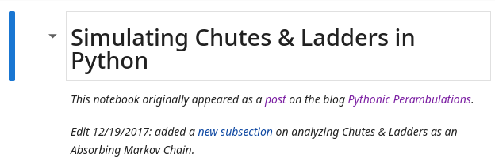
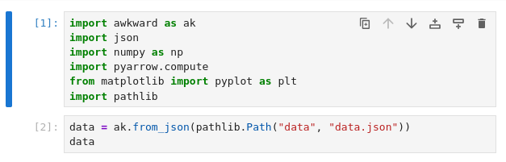

---
authors:
  - name: Angus Hollands
    affiliations:
      - 2i2c
    orcid: 0000-0003-0788-3814
    github: agoose77
    bluesky: "@agoose77.bsky.social"
    mastodon: "@agoose77@fosstodon.org"
kernelspec:
  name: python3
  display_name: Python3
date: 2026-11-03
---

# Executable Notebooks in Scientific Publishing Workflows

::::{figure} /media/my-face.webp
:width: 768px

:::{div .m-text-3xl}
👋 I'm Angus Hollands

I'm an Open Source App/Infra Engineer at !
:::
::::

## Foreword

I used Jupyter Book 1 to author my PhD thesis 🎓. {span .fragment .m-decoration-pink-500 .m-underline}`The content was questionable.` {span .fragment}`The subsequent journey was not!`

:::{iframe} https://agoose77.github.io/phd-thesis

:::

% graduated from user to contributor
% saw the project move from v1 to v2

## The Team

:::{aside .notes}

Of importance: pathway from user to contributor. We're an open project!

:::

::::{grid .m-max-w-3xl} 4 4 4 4

:::{card} Chris Holdgraf

:::

:::{card} Serena Bonaretti

:::

:::{card} Stefan van der Walt

:::

:::{card} Steve Purves

:::

:::{card} Rowan Cockett

:::

:::{card} Franklin Koch

:::

:::{card} Angus Hollands

:::

:::{card} Greg Caporaso

:::

::::

# Scientists use Notebooks

Many scientists use Jupyter Notebooks to Do Science™ {span .fragment}``Notebooks are built from {span .m-text-red-500}`Markdown cells,` `` {span .fragment .m-text-green-500}`Code cells,` {span .fragment}``and {span .m-text-blue-500}`Kernels` that run code.``

:::::{exercise .fragment}
:label: ex:research
What does an actual research notebook look like?
::::{grid} 2 2 2 2
:::{card}
:link: http://localhost:8888/lab/tree/analysis/snakes-and-ladders.ipynb

:::

:::{card}
:link: http://localhost:8888/lab/tree/analysis/nettie-dog-flap-visits.ipynb

:::

::::
:::::

:::{solution .fragment} ex:research
Notebooks are _never_ clean. They're always {span .fragment}`rushed,` {span .fragment}`hacky,` {span .fragment}`` and called `untitled.ipynb`.``
:::

## Help, my Notebooks are Ugly!

:::::{exercise .fragment}
:label: ex:ugly
You have an ugly research notebook that others want to see 🖼️. Do you ...
::::{grid} 2 2 2 2
:::{card}
Share the ugly notebook, because you're confident 😎
:::

:::{card}
Absolutely do not do that 💀
:::

::::

:::{image} /media/ugly-meme.png
:width: 500px
:::
:::::
:::{solution .fragment} ex:ugly
There's another way ...

:::

(slide:superpowers)=

## But first ... Jupyter Book's SuperPowers 🦸‍♀️

:::{div #myst-superpowers}
There are quite a few documentation engines!

- {span .fragment}`Quarto`
- {span .fragment}`Sphinx`
- {span .fragment}`Typst`
  :::

{span .fragment}`We think that Jupyter Book has certain super-powers that make it stand out...`

# 🦸‍♀️ MyST Markdown (✍️): Better Markdown

:::{figure} /media/rich-markup.jpg

:::

## 🦸‍♀️ MyST Markdown (✍️): Better Markdown

A CommonMark derivative that is {span .fragment}`Natural like Markdown` and {span .fragment}`Expressive like Restructured Text (ReST)`.

```{preview .fragment}
:::{tip}
We'll show more MyST Markdown during this talk
:::
```

:::{div .notes}
These preview blocks show MyST Markdown source, and what it renders out to.
:::

# 🦸‍♀️ XRefs (🖇️): Links are Powerful

MyST can connect different parts of a project using cross-references.

```{preview}
See @slide:superpowers!
```

## 🦸‍♀️ XRefs (🖇️): Names create Targets

Adding a `name` makes something referenceable!

```{preview}
:::{figure} https://picsum.photos/500/150
:name: my-figure
:::

See @my-figure
```

## 🦸‍♀️ XRefs (🖇️): Labels are Smart

Different targets get different labels!

```{preview}
:::{math}
:name: my-eqn

E^2 = (mc^2)^2 + (pc)^2
:::

See @my-eqn and @my-figure

```

# 🦸‍♀️ Embeds (🖨️): XRefs-in-action

Content can be embedded in multiple places!

```{preview}
Here's the earlier equation:

```

## 🦸‍♀️ Embeds (🖨️): Ugly Notebooks 🦢, Beautiful Prose 💫

Let's put 🐕 and 🖇️ and 🖨️ together! {button}`Go to Notebook →<http://localhost:8888/lab/tree/analysis/nettie-dog-flap-visits.ipynb>`

```{preview .fragment}
Here's my consequential result concerning dog visits to the outside world... 
```

:::{div .notes}
Show what happens when we clear outputs of that cell.
:::

## Embeds (🖨️): Separate the Reading from the Doing

Using embeds, we can separate the {span .m-text-red-500}`reading of scientific results` from the {span .m-text-green-500}`work that we did to get them`.

These are two different mind-sets!

---

::::{grid} 2

````{preview} analysis.md
```{code-cell} python3
import numpy as np
from matplotlib import pyplot as plt

x = np.arange(512); y = (x - 4)**2 + 2; y.shape
```
```{code-cell} python3
#| label: plot
plt.figure(); plt.plot(x, y)
```
````

```{preview} paper.md
## Graphs!
The graph of {math}`y = (x-4)^2 + 2` is as follows:[^from-nb]

[^from-nb]: I ran a notebook to compute this.
```

::::

# 🦸‍♀️ Execution (⚡): Generate your outputs

We can execute in Markdown documents!

````{preview}
```{code-cell} ipython
start = "You were only supposed to"
end = " blow the bloody doors off 🚘💥"
print(start + end)
```
````

## 🦸‍♀️ Execution (⚡): Interpolate your Variables

Inline expressions can also be embedded in your prose:

```{preview}
It started like {eval}`start`
```

## 🦸‍♀️ Execution (⚡): Cache the Results

Jupyter Book remembers the inputs and stores the outputs for next time.

You can tweak this using the `cache` or `depends_on_env` [settings](xref:guide#execute-config).

## 🦸‍♀️ Execution (⚡): Use Complex Environments

Each file can use a different kernel.

Tools like Pixi _can_ be set-up to create separate environments with separate kernels.

## 🦸‍♀️ Execution (⚡): Use Remote Executors

You can [run your book execution remotely](xref:guide/execute-notebooks#manually-launch-a-jupyter-server) on a BinderHub or JupyterHub! {button}`Launch on MyBinder.org<https://mybinder.org/v2/gh/agoose77/delft-slides-2026/requirements-v1>`

```bash
JUPYTER_BASE_URL=xxx JUPYTER_TOKEN=yyy jupyter book start --execute
```

# 🦸‍♀️ DOIs & Citations (🏷️): Directly use DOIs

```{preview}
{abbr}`DOI (Digital Object Indentifier)`s are Digital Object Identifiers.

The LIGO result was published with a DOI: <doi:10.1103/PhysRevLett.116.061102>
```

## 🦸‍♀️ DOIs & Citations (🏷️): Connect with BibTex

```{preview}
I also read something interesting in @theHiggsBoson
```

:::{div .fragment}

Citations can be narrowed to particular pages, like Pandoc:

```{preview }
Perhaps I saw it at [@theHiggsBoson, p23]?
```

:::

See [the guide](xref:guide/citations#markdown-citations) for more

## 🦸‍♀️ DOIs & Citations (🏷️): Use Remote Bibliographies

A project can use multiple bibligraphies, and they can be URLs!

```yaml
project:
  bibliography:
    - https://.../my-bibliography.bib
```

{span .fragment}`This makes it easy to share bibliographies between projects and departments.`

# 🦸‍♀️ Content as Data (💽): The ✨ Under the Hood

Every Jupyter Book is a rich data store, e.g. the MyST Guide:

```{preview}

```

## 🦸‍♀️ Content as Data (💽): XRefs (🖇️)

Each Jupyter Book has a [`myst.xref.json`](https://mystmd.org/guide/myst.xref.json):

```{iframe} https://mystmd.org/guide/myst.xref.json

```

## 🦸‍♀️ Content as Data (💽): Pages (📄)

Every page has its own structured representation, e.g. [`proofs-and-theorems`](https://mystmd.org/guide/proofs-and-theorems.json). Just add `.json`:

```{iframe} https://mystmd.org/guide/proofs-and-theorems.json

```

## 🦸‍♀️ Content as Data (💽): Pages (📄)

```{code-cell .side-by-side} python3
import urllib.request, json, pprint
with urllib.request.urlopen(
    "https://mystmd.org/guide/proofs-and-theorems.json"
) as page:
    data = json.load(page)

def walk(tree):
    for child in tree.get("children", []):
        yield child
        yield from walk(child)

for node in walk(data["mdast"]):
    if node.get("identifier") == "my-theorem" and node["type"] == "proof":
        pprint.pprint(node)
```

## 🦸‍♀️ Content as Data (💽): MyST Sandbox

```{iframe} https://mystmd.org/sandbox?tab=ast&myst=VABoAGUAIABjAGEAdAAgAF8AcwBhAHQAXwAgAG8AbgAgAHQAaABlACAAKgAqAG0AYQB0ACoAKgA%3D

```

## 🦸‍♀️ Content as Data (💽): MyST Spec

Jupyter Book supports MyST Markdown as an input.

It outputs MyST AST, [governed by a spec](xref:spec#flowcontent).

# 🦸‍♀️ Extensible Syntax (🧩): Roles

Jupyter Book makes it easy to add new roles.

:::{note} Reminder!
A `role` is a small piece of inline MyST Markdown markup of the form

```markdown
{role-name}`role-content`
```

:::

You might want to do this to make your documents easier to read and write.

## 🦸‍♀️ Extensible Syntax (🧩): Adding a Role

Roles are written in JavaScript, TypeScript, and even Python or Bash!

::::{div .side-by-side}

```{literalinclude} /role.mjs

```

```{preview}
{life}`I always wondered, why is the meaning of life {}?`
```

::::

## 🦸‍♀️ Extensible Syntax (🧩): Directives

Adding new directives is just as easy.

::::{note} Reminder!
A `directive` is a piece of block-level MyST Markdown markup of the form

```markdown
:::{directive-name} direcive-arg
:directive-option: value

directive-body
:::
```

::::

## 🦸‍♀️ Extensible Syntax (🧩): Adding a Direcive

Directives are also written in JavaScript, TypeScript, and even Python or Bash!

::::{div .side-by-side}

```{literalinclude} /directive.mjs

```

```{preview}
:::{legit-quote}
Life, Laugh, Love
:::
```

::::

## 🦸‍♀️ Frontend Anywidgets

You can create small self-contained JavaScript "anywidgets" for extra interactivity

```{preview}
:::{anywidget} https://github.com/jupyter-book/example-js-anywidget/releases/latest/download/widget.mjs
:::
```

# Using JupyterLab: `jupyterlab-myst`

Jupyter Book has some early support for JupyterLab. It can:

- Render `admonitions`
- Handle in-page XRefs
- Display figures
- Show DOI references and footnotes

{button}`See an example<http://localhost:8888/lab/tree/analysis/inline-interactivity.ipynb>`


## Using JupyterLab: 🧭 Where We're Going

There is lots that `jupyterlab-myst` can't do.

We want to improve this! {button}`See a prototype`

# Project Timeline

:::{image} /media/timeline.svg
:width: 1024px
:::

manim

# How Jupyter Book Works 🛠️

## Life of a Jupyter Book Project

:::{image} /media/life-myst-markdown.svg
:width: 1024px
:::

## Per-document AST are Transformed

:::{image} /media/per-document-ast.svg
:width: 1024px
:::

## The Result is JSON!

:::{image} /media/myst-site-build.svg
:width: 1024px
:::

# Confusing Points 🙁

# Thank you

```{slide-authors}
:socials:
```

```{slide-socials}

```
